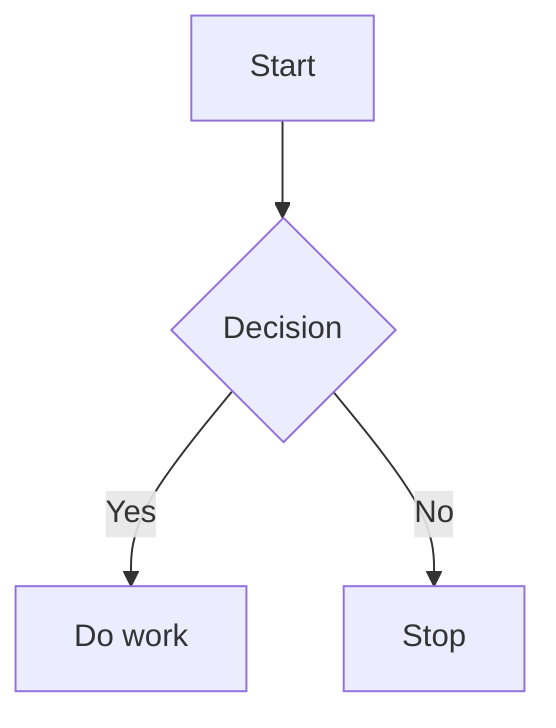

# Mermaid Flow Zoom

Mermaid Flow Zoom improves rendered Mermaid diagrams in Obsidian with zooming, panning, and fullscreen viewing.

## Features

- Click a diagram to focus it; zooming and panning only work while it is focused, so scrolling the note is never hijacked. Click outside or press `Esc` to release it.
- Mouse wheel zooms around the pointer.
- Drag to pan the diagram.
- Trackpad horizontal scrolling, `Shift` + wheel, or wheel near the left/right edge pans horizontally.
- Toolbar controls for zoom in, zoom out, reset, fullscreen, and a `?` help popover listing all controls.
- Reset and first render fit the complete Mermaid SVG proportionally and center it in the container.
- Mobile one-finger pan and two-finger pinch zoom.
- Works with dynamically rendered Mermaid diagrams in Reading view and Live Preview where Obsidian exposes rendered SVGs.

## Installation

This fork isn't in the Obsidian community plugin directory. Searching there for `Mermaid Flow Zoom` installs the original plugin, not this fork. Both use the id `mermaid-flow-zoom`, so only one of them can be installed in a vault.

### From source

Requires Node.js and pnpm.

```sh
cd <vault>/.obsidian/plugins
git clone https://github.com/thascius-rumpelschnick/mermaid-flow-zoom.git
cd mermaid-flow-zoom
pnpm install
pnpm run build
```

Then reload Obsidian and enable `Mermaid Flow Zoom` under **Settings → Community plugins**.

### From a release

1. Download `main.js`, `manifest.json`, and `styles.css` from the latest release of [this fork](https://github.com/thascius-rumpelschnick/mermaid-flow-zoom/releases).
2. Create this folder inside your vault:

```text
<vault>/.obsidian/plugins/mermaid-flow-zoom/
```

3. Put the downloaded files in that folder.
4. Reload Obsidian.
5. Enable `Mermaid Flow Zoom` under **Settings → Community plugins**.

## Usage

Open a note containing a Mermaid diagram, for example:

````markdown

````

After Obsidian renders the diagram, use the mouse, touchpad, toolbar, or touch gestures to inspect the flowchart.

## Release Checklist

For each GitHub release, attach these files as release assets:

- `main.js`
- `manifest.json`
- `styles.css`

The release tag must exactly match the `version` in `manifest.json`, for example `1.0.0`.

## License

MIT

## Credits

Fork of [Mermaid Flow Zoom](https://github.com/Change-Wyc/mermaid-flow-zoom) by Change-Wyc, maintained by Florian Zapf.

## Links

- Fork: https://github.com/thascius-rumpelschnick/mermaid-flow-zoom
- Original: https://github.com/Change-Wyc/mermaid-flow-zoom
- Original in the community plugin directory: https://community.obsidian.md/plugins/mermaid-flow-zoom
